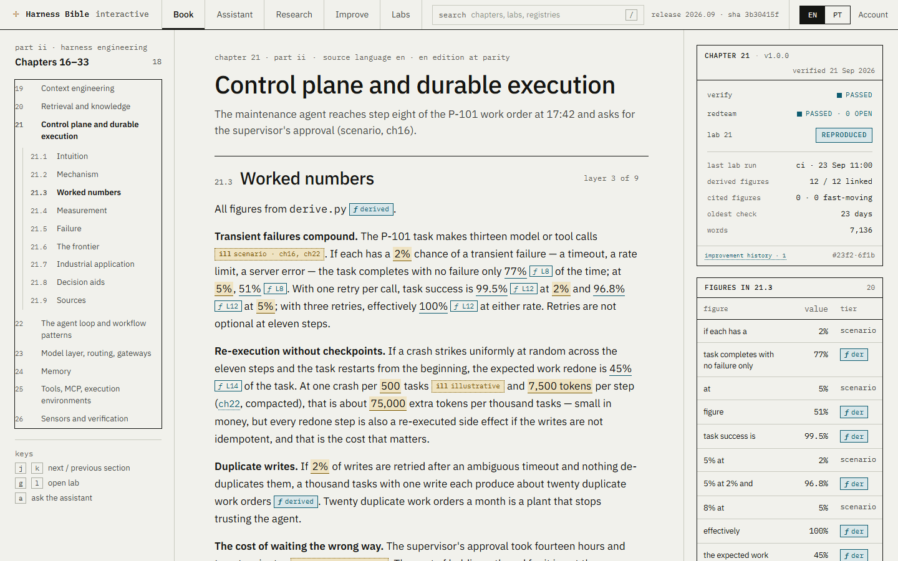
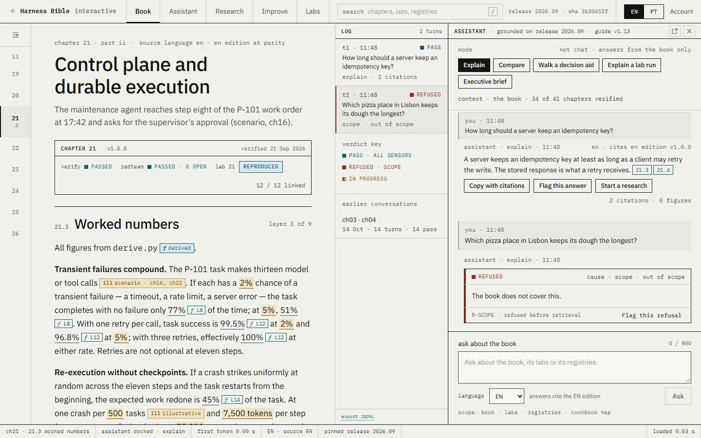
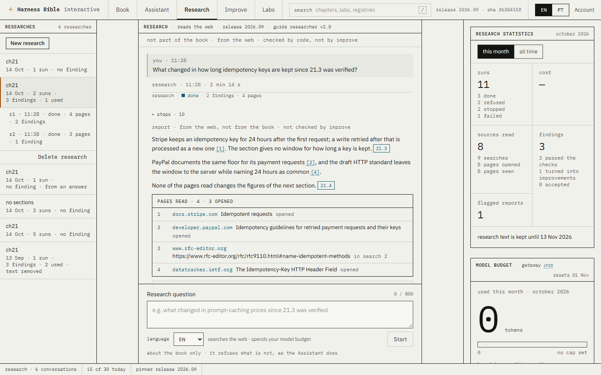
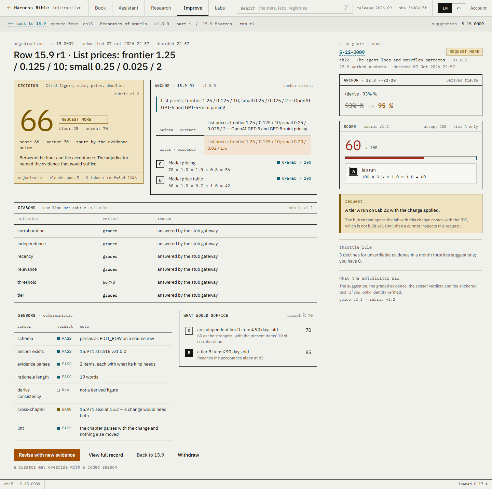
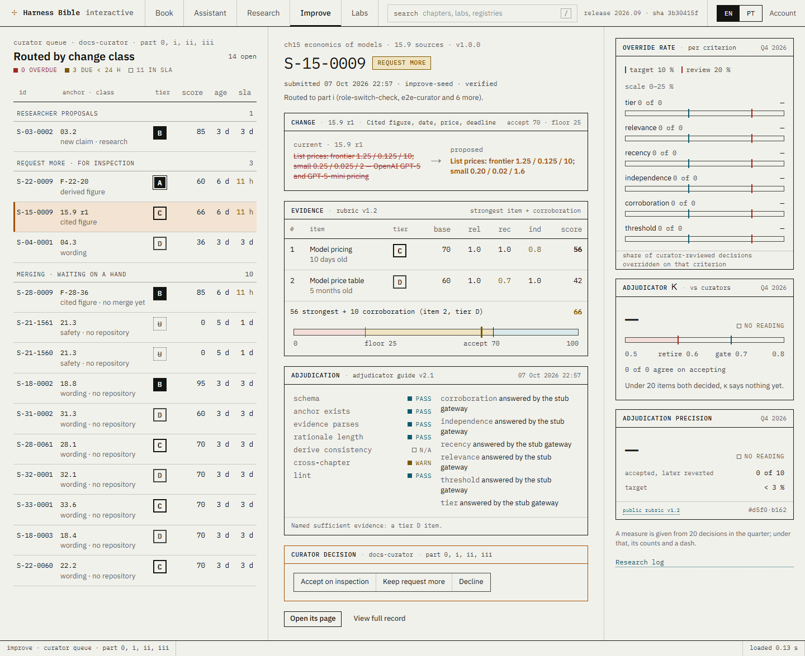
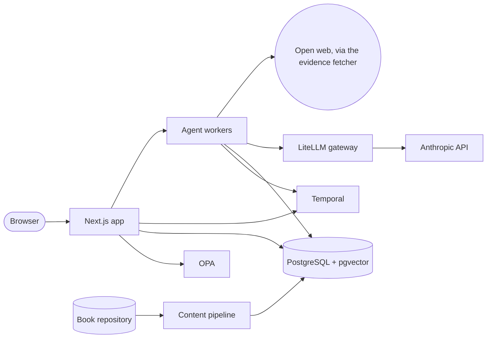

# Harness Bible Interactive

**A technical book on LLM harness engineering, made interactive, and built from the harness it describes.**

[![CI][ci-badge]][ci]
[](LICENSE)
[](https://nodejs.org/)
[](https://nextjs.org/)

*The Harness Bible* is a 41-chapter engineering reference on large language models and the harnesses around them:
context, retrieval, durable execution, gateways, sensors, graders, policy, observability. This app turns it into a
working tool, and builds that tool from the very components the book describes: sensors, a model gateway with hard
budgets, a workflow engine, a policy engine, isolated graders and a hash-chained ledger. Then it shows them on screen
(versions, hashes, budgets, scores, run logs) instead of hiding them.



## What it is

| Pillar | What it does |
| --- | --- |
| **Reader** | The book by part, chapter and layer, pinned to a release. Every number carries its provenance: the source tier it was cited from, the line of the lab's `derive.py` that computed it, or an *illustrative* mark. Peeks, hybrid search, reading paths, PT and EN. |
| **Assistant** | Answers **only from the book**, with a section cited for every claim. A scope sensor refuses before retrieval. A citation sensor, an edition sensor and an isolated grounding grader check every answer before it is final, and every answer is a ledger record. |
| **Research** | When a person asks, an agent reads the web around the book's sections, writes that person a report with every page it read, and proposes up to three anchored changes. The agent that reads the web **never sees the question**. |
| **Improve** | Evidence-graded editing. A change is anchored to a section, figure or source row. Its evidence is fetched and graded A–G or U against a public rubric. The score is **computed in code**, an adjudicator recommends in an isolated context, and a curator decides. Every step is hash-chained. |

<p>
  
  
  
  
</p>

**[Take the walkthrough →](docs/walkthrough.md)**

## Why it is interesting

The book argues that what makes an LLM product dependable is the harness around the model. This repository is that
argument, running:

- **Grounded answers, checked by sensors.** Retrieval is a single SQL statement fusing `tsvector` and pgvector ranks
  over the pinned release. Tokens stream over SSE, but citations and verdicts arrive only in the final event. An
  uncited claim is replaced server-side by "the book does not cover this", and numbers are copied from the book,
  never recomputed by the model.
- **A researcher that never sees your question while it reads the web.** Three model calls share nothing but what
  code passes between them. A planner (no tools, no web) writes a brief that a sensor checks for secrets, addresses
  and copied phrases. A reader with the provider's web search and fetch sees only that brief and the book. A writer
  with no tools turns the reader's notes into the report. A page that tries to steer the agent can, at most, put
  words in a report labelled as from the web, or propose a change that is then graded like anyone's. It cannot
  make the agent act.
- **A rubric computed in code.** The score is the **strongest** evidence item's adjusted score plus at most one +10
  for corroboration, never a sum. Thresholds and routing are recomputed in `lib/rubric/`, at 100 % branch coverage,
  with the rubric's four worked examples as fixtures. A model's output is a classification, never a number the app
  trusts. Safety and OT-boundary changes always go to a human.
- **A tamper-evident ledger.** One append-only chain for the whole product: RFC 8785 canonical JSON, SHA-256, a
  genesis hash, a single writer enforced in CI, a database trigger against updates, and audit exports with an
  Ed25519-signed trailer that verifies with the public key alone.
- **Policies in OPA, failing closed.** Every route handler asks a Rego policy before it touches data. Tenants,
  rosters, roles and agent identities are all policy, with a test for every deny case. If OPA is unreachable, the
  answer is no.
- **Budgets by construction.** Only the workers call the model gateway, and only the gateway holds provider keys.
  LiteLLM enforces each principal's hard cap before the call. No application code counts tokens to decide anything.
- **Everything observable.** Structured lines become OpenTelemetry spans, with the collector, Tempo, Loki and Grafana
  in a compose profile. Every model call logs its guide version, pinned model id and prompt hash. Agent guides are
  versioned files pinned by hash.
- **Built spec-first with an AI coding agent.** 49 feature specs, one small unit of work at a time, one review per
  unit. See [how it was built](docs/how-it-was-built.md).

## Quick start

You need Node 24, Docker, and the [OPA](https://www.openpolicyagent.org/) binary on your `PATH`.
**No model key is needed:** a stub gateway stands in for the model provider.

```bash
git clone https://github.com/aqueirozbr-vibez/harness-bible.git app
git clone https://github.com/aqueirozbr-vibez/harness-bible-book.git bible     # the book, beside the app (BOOK_DIR=../bible)
cd app && cp .env.example .env     # then fill the generated secrets: docs/getting-started.md § 3
docker compose up -d db temporal-namespace
npm ci && npm run db:deploy
npm run ingest && npm run db:seed && npm run rubric:publish -- v1.2
npm run dev                        # terminal 1: the app on :3000, OPA, the stub gateway
npm run workers                    # terminal 2: the agent workers
```

Sign in at `http://localhost:3000/api/v1/auth/dev?email=you@harness-bible.local&next=/en`. For the demo data, run
`npm run improve:seed`, then sign in once as `demo@harness-bible.local` and run `npm run research:seed`. The full guide, with every variable explained, is
**[docs/getting-started.md](docs/getting-started.md)**.

### What needs a key, and what does not

| Runs with no key (stub gateway) | Needs an Anthropic key (through the LiteLLM gateway) |
| --- | --- |
| Reader, search, paths, bookmarks and notes, PT and EN | Real Assistant answers (the stub's answers are deterministic plumbing, not prose) |
| Improve's pages, the curator queue, the ledger, audit export, Book management | Real evidence grading and adjudication of new suggestions |
| The demo seeds, every test suite and every gate in CI | Real research on the open web (about US$ 0.60 a run) |
| Research and the Assistant end to end, on the stub's fixtures | Semantic search on real embeddings (self-hosted, no provider tokens) |

The provider key lives only in `infra/gateway/.env`, which only the gateway container reads.

## Architecture



The web tier never calls a model. The workers are the only process that calls the gateway or opens a URL a stranger
chose. Content rows are immutable per release and change only through Improve. More detail:
**[docs/architecture.md](docs/architecture.md)**. The full contract, with every route, table, threat and invariant,
is **[context/architecture.md](context/architecture.md)**.

## Repository map

| Path | What lives there |
| --- | --- |
| [`app/`](app/) | Next.js App Router: pages under `[lang]/` (EN and PT), the REST API under `api/v1/` |
| [`components/`](components/) | UI by feature: reader, assistant, research, improve, admin, chrome |
| [`lib/`](lib/) | zod schemas, database doors, rubric arithmetic, ledger, policy client, gateway client, sensors, search |
| [`workers/`](workers/) | Temporal workflows and activities, each agent's prompt assembly, the evidence fetcher, the research run |
| [`pipeline/`](pipeline/) | The content pipeline: book release → immutable rows → render hash |
| [`policies/`](policies/) | Rego policies and their tests |
| [`guides/`](guides/) | The agents' guides (Assistant, grader, adjudicator, researcher), versioned and pinned by hash |
| [`rubric/`](rubric/) | The evidence rubric, versioned and pinned by hash |
| [`prisma/`](prisma/) | Schema and forward-only migrations |
| [`infra/`](infra/) | LiteLLM config and the stub gateway, Keycloak realm, Temporal, workers image, observability, schedules |
| [`golden/`](golden/), [`aids/`](aids/) | The Assistant's golden set; decision aids that run a chapter's own `derive.py` |
| [`messages/`](messages/) | The EN and PT catalogues |
| [`tests/`](tests/) | Contract, integration, workflow, end-to-end (Playwright + axe) and layout suites |
| [`scripts/`](scripts/) | Seeds, gates and operator commands |
| [`context/`](context/) | The specification: product overview, architecture, UI, code standards, workflow rules, [feature specs](context/feature-specs/) |
| [`docs/`](docs/) | [Walkthrough](docs/walkthrough.md), [getting started](docs/getting-started.md), [architecture](docs/architecture.md), [how it was built](docs/how-it-was-built.md), the [design package](docs/design/) |

## Status

Built: the Reader, the Assistant, Improve and the Researcher, each with a gate script that measures its success
criteria and reports `pass`, `fail` or `blocked`. Some criteria are blocked on things that need people or money,
such as curator-labelled sets and paid golden runs. **Not built:** the Labs IDE (a Firecracker microVM per session
that re-runs a chapter's lab and diffs its figures) was deliberately left for last, so a saved lab run as tier-A
evidence waits for it. Merges go to a local Git copy of the book until the book's hosted repository and CI are wired
in.

## The book

The book itself lives in its own repository, **[harness-bible-book][book]**: its text under CC BY 4.0, its lab code
under MIT. It holds the chapters, the registries and the 34 labs whose `derive.py` scripts produce the book's derived
figures. This app reads a pinned release of it from `BOOK_DIR`.

## Contributing

Issues and pull requests are welcome: see [CONTRIBUTING.md](CONTRIBUTING.md), and please follow the
[code of conduct](CODE_OF_CONDUCT.md). Report security issues privately, as [SECURITY.md](SECURITY.md) describes.
To propose a change to the book's content, use the book's repository, or run the app and use Improve.

## License

The app is [MIT](LICENSE). The book's text is CC BY 4.0 and its lab code MIT, in [its own repository][book].

## Acknowledgements

Built on [Next.js](https://nextjs.org/), [React](https://react.dev/), [Prisma](https://www.prisma.io/),
[PostgreSQL](https://www.postgresql.org/) with [pgvector](https://github.com/pgvector/pgvector),
[Temporal](https://temporal.io/), [Open Policy Agent](https://www.openpolicyagent.org/),
[LiteLLM](https://github.com/BerriAI/litellm), [Infinity](https://github.com/michaelfeil/infinity) serving
[BAAI](https://huggingface.co/BAAI) `bge-m3` and `bge-reranker-base`, [Mermaid](https://mermaid.js.org/),
[next-intl](https://next-intl.dev/), [zod](https://zod.dev/), [Vitest](https://vitest.dev/),
[Playwright](https://playwright.dev/) with [axe-core](https://github.com/dequelabs/axe-core), the
[OpenTelemetry](https://opentelemetry.io/) and [Grafana](https://grafana.com/) stacks, and the
[IBM Plex](https://www.ibm.com/plex/) typefaces. Models are Anthropic's [Claude](https://www.anthropic.com/claude),
reached only through the gateway. The code was written with [Claude Code](https://claude.com/claude-code).

[ci]: https://github.com/aqueirozbr-vibez/harness-bible/actions/workflows/ci.yml
[ci-badge]: https://github.com/aqueirozbr-vibez/harness-bible/actions/workflows/ci.yml/badge.svg
[book]: https://github.com/aqueirozbr-vibez/harness-bible-book
