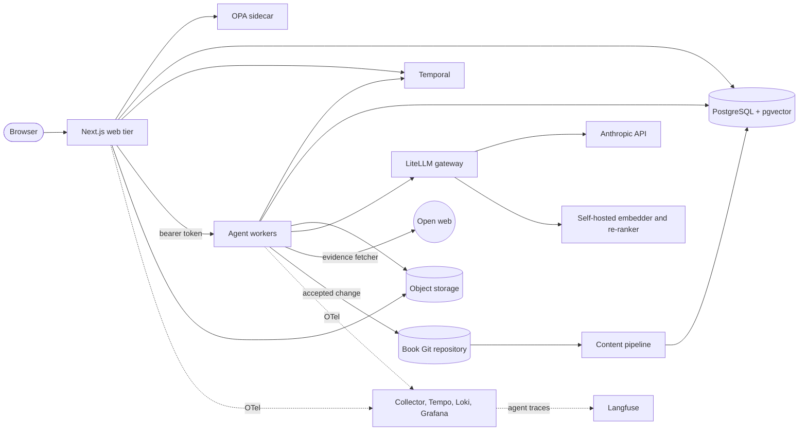
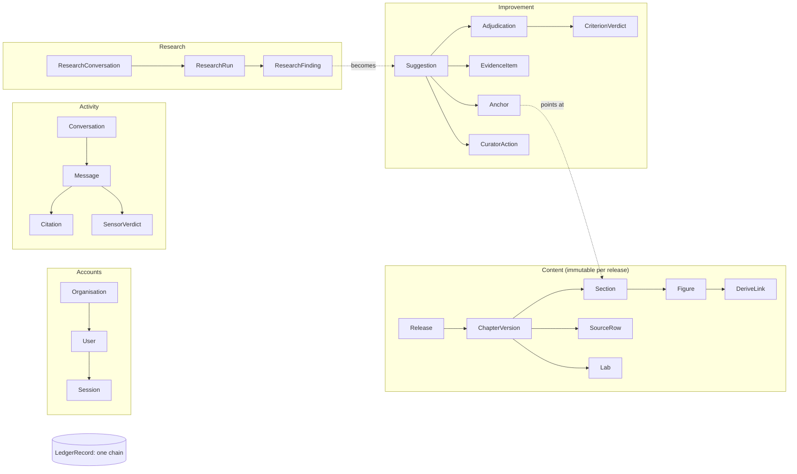
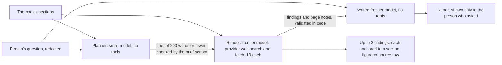
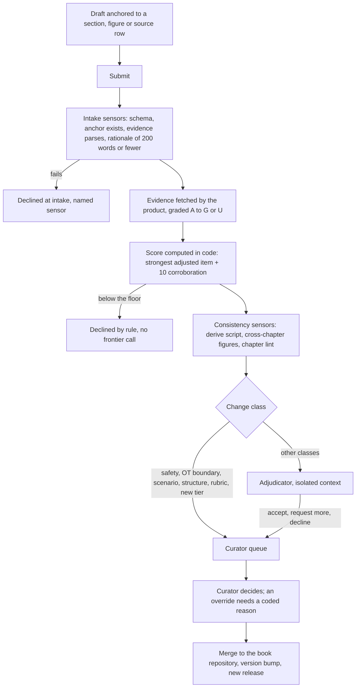
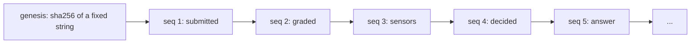

# Architecture

A public overview. The full contract, with every table, route, threat and invariant, is
[`context/architecture.md`](../context/architecture.md). The product definition is
[`context/project-overview.md`](../context/project-overview.md). Each feature's design is a spec in
[`context/feature-specs/`](../context/feature-specs/).

The one idea behind the design: **the product is the book's own harness, applied to the book.** The book describes
intake sensors, a model gateway with hard budget caps, a workflow engine, a policy engine, isolated graders and a
hash-chained ledger. The app is built from exactly those components. It also shows them on screen (versions,
hashes, budgets, scores, run logs) instead of hiding them. Where this page says *ch21* or *ch28*, that chapter of the
book is the component's design document.

- [Containers](#containers)
- [The rules that do not bend](#the-rules-that-do-not-bend)
- [Data model at a glance](#data-model-at-a-glance)
- [The agents and their guides](#the-agents-and-their-guides)
- [Improve: from evidence to a decision](#improve-from-evidence-to-a-decision)
- [The policy layer](#the-policy-layer)
- [The ledger](#the-ledger)
- [Observability](#observability)
- [Stack choices](#stack-choices)
- [Not built yet](#not-built-yet)

## Containers

| Container | Responsibility | Never |
| --- | --- | --- |
| **Web tier** (Next.js App Router, RSC, route handlers under `/api/v1`) | Every screen. The REST API with an OpenAPI 3.1 document generated from shared zod schemas. Starts and signals workflows. Asks OPA before touching data. | Calls the gateway or holds a provider key. Parses Markdown at request time. |
| **Agent workers** (`workers/`) | Temporal workers and a small private HTTP surface. The assistant loop, the researcher, the evidence fetcher and grader, the adjudicator, and the merge's Git adapter. **The only container that calls the gateway, and the only one that opens a URL a stranger chose.** | Writes content rows. |
| **Content pipeline** (`pipeline/`) | Book release → immutable rows per release → full-text index → render hash. Ingestion is idempotent per Git SHA. | Edits the book's source except through an accepted change. |
| **PostgreSQL** (pgvector, `pg_trgm`) | Content, accounts, activity, improvement, the ledger, and the hybrid search index, all in one store. | — |
| **Temporal** | Durable workflows for suggestions, research runs, merges and audit exports. Curator decisions arrive as signals. | Holds a reader's words: histories carry ids, enumerations and hashes. |
| **OPA** | Policy decision point beside the web tier. Default deny, Rego in Git. | Fails open: if OPA is unreachable, the answer is deny. |
| **LiteLLM gateway** | Per-principal virtual keys with hard budgets enforced before the call, provider routing, version pinning, cost. Four aliases: `hb-frontier`, `hb-small`, `hb-embed`, `hb-rerank`. | Lets any other process near a provider key. |
| **Object storage** | Uploaded and fetched evidence, audit packs. A local directory behind signed URLs for now, behind an S3-shaped interface. | — |

A **stub gateway** (`infra/gateway/stub/`) stands in for LiteLLM in development and CI. It exposes the same aliases,
mints keys the same way, refuses at the same cap, and answers deterministically without a provider.

## The rules that do not bend

`context/architecture.md` § 11 lists the invariants. A change that breaks one is a defect, whatever the tests say. The
ones that shape the system most:

- **Content is immutable per release.** A new release inserts new rows. The reader renders only `Release.current`.
  Content changes only through Improve: a branch in the book repository, a curator's merge, a new release.
- **Only the workers call the gateway, and only the gateway calls a provider.** Budgets are enforced at the gateway,
  never by application code counting tokens.
- **Numbers come from code, not from models.** Scores, thresholds, routing and change classes are recomputed in
  `lib/rubric/`. A model's output is a classification, never a number the app trusts.
- **Sensors run before any judgment.** Intake sensors and the score floor run before a frontier call can be spent.
  Consistency sensors run before the adjudicator. The citation sensor runs before an answer is final.
- **The adjudicator never sees who you are.** Its input is assembled from ledger rows. Identity appears only as
  `verified: true`.
- **The researcher's reader never sees the question.** The agent that reads the web knows the book and a brief that
  code checked, and nothing of the person who asked.
- **One ledger, append-only.** Every adjudication, override, merge, answer and export is a hash-chained record.

## Data model at a glance

One Prisma schema in five domains, read left to right:

- Ids are anchors that recur in every release: section `21.3`, figure `F-21-03`, source row `21.9 r4`, lab `lab-21`.
- Every account-scoped row carries `organisationId`. A Prisma client extension adds the tenant filter to every
  query. The improvement tables are the platform's, and one module, `lib/db/improve.ts`, is their only door. A CI step
  greps for any other.
- Retention: Assistant and research text is purged after 30 days. Citations, verdicts, counts and hashes stay.
  Ledger records are never deleted, and their payloads carry hashes of free text rather than the text.

## The agents and their guides

Every agent has a **versioned guide** in [`guides/`](../guides/), pinned by a manifest hash and assembled into a
byte-stable prefix so that prompt caching works. Every agent also has a structured output schema, sensors on both
sides, and a fixed cap. Prompts are assembled only in `workers/agents/<agent>/assemble.ts`. The function's parameter
type lists exactly what the agent may read, so a forbidden field cannot even be passed.

| Agent | Model | Reads | Never reads | Sensors after | Cap |
| --- | --- | --- | --- | --- | --- |
| **Assistant** (`guides/assistant/`) | frontier to draft, small to classify scope | retrieved sections, the conversation, decision-aid results | anything outside the corpus, who is asking | citation sensor, edition sensor, grounding grader in an isolated context | one repair pass |
| **Evidence grader** (`guides/grader/`) | small | the evidence as the product fetched it, as fenced untrusted data, and the anchored claim | the contributor, other suggestions | score arithmetic recomputed in code | one attempt; failure = tier U |
| **Adjudicator** (`guides/adjudicator/`) | frontier | the suggestion, graded evidence, sensor verdicts, the anchored text | identity beyond `verified: true`, curator notes, other suggestions | decision re-checked against the thresholds in code | one attempt; failure = curator queue |
| **Researcher** (`guides/researcher/`) | three calls, below | — | — | — | one attempt each |

The researcher is three model calls that share no context except what code passes between them:

- The **planner** reads the question and the book, never the web. Its brief is refused if it contains a secret, an
  address, a run of digits, or five consecutive words of the question.
- The **reader** reads the brief, the target sections, and what its two tools return. It never sees the question,
  the answer or the asker. Every finding must cite pages that this call really opened, or code drops it.
- The **writer** holds the question but has no tool and never sees a page, only the reader's notes. A report sensor
  checks each paragraph's references and refuses addresses, secrets and instructions about operating equipment.
- A finding becomes a book change only through Improve. The product's own fetcher opens every source again, the
  grader grades it, the score is computed in code, and a curator decides. There is no list of trusted sites: the
  rubric decides what a source is worth.

## Improve: from evidence to a decision

The rubric (`rubric/v1.2/rubric.json`, published at `/[lang]/rubric`) gives each evidence tier a base score:
A reproducible 100, B primary published 85, C primary vendor 70, D independent analyst 60, E practitioner 40,
F reported 25, G opinion 5, U unverifiable 0. Each item is adjusted for relevance, recency (fast-moving figures only)
and independence. A suggestion's score is its **strongest** item plus at most one +10 for corroboration, **never a
sum**. Ten weak items never equal one strong one. The four worked examples of the rubric are fixtures that CI checks
to the number, at 100 % branch coverage.

## The policy layer

[`policies/hb/`](../policies/hb/) holds the Rego that every route handler consults before it reads or writes: roles,
ownership, tenant isolation, curator rosters per part, and what each service identity may do. Two examples:
`service:adjudicator` may never decide a curator-only change class or a researcher's proposal, and a curator whose
roster does not cover the chapter's part may not decide either. The default is deny, an unreachable OPA is a deny, and every deny case has a test in
[`policies/tests/`](../policies/tests/) (`opa test policies -v` in CI).

## The ledger

- One chain for the whole product, ordered by `seq`. Each record's hash is SHA-256 over its RFC 8785 canonical JSON,
  and that JSON includes the previous record's hash. A per-suggestion or per-chapter view is a filter on the chain,
  not a second chain.
- Append-only three times over: a single writer (`lib/ledger/append.ts`, which a CI grep enforces), a client
  extension that refuses updates and deletes, and a database trigger that raises on them.
- The record page re-verifies the chain on every view. Exports are JSONL with a trailer signed with Ed25519, which
  verifies with the public key alone. A per-chapter export carries its records' chain neighbours, so gaps still
  verify.

## Observability

- Every line the product logs is structured JSON. When `OTEL_EXPORTER_OTLP_ENDPOINT` is set, the web tier, the
  workers and the scheduled jobs export the same lines as OpenTelemetry spans (GenAI semantic conventions on model
  calls). No span carries a prompt, an answer, a question, an e-mail or a key.
- `docker compose --profile observe up -d` starts the collector, Tempo, Loki and Grafana. The dashboards are
  provisioned from [`infra/observability/`](../infra/observability/). They read series computed from the product's
  own rows, through a database role that can read only the columns the dashboards need.
- The gateway reports cost and usage per call. [Spec 49](../context/feature-specs/49-langfuse.md), being built,
  sends the agents to Langfuse: every model call named for its agent, and a turn, a research run and a suggestion
  one trace each. The collector is the only road there. The app, the workers and the gateway hold no Langfuse key,
  and prompt and answer text is sent in development only, behind two switches.
- The Assistant and the Research page show each person their own statistics (citation rate, refusal rate by cause,
  first-token p95, grounded score, cost per run), counted from their own rows.

## Stack choices

Each choice in `context/architecture.md` § 1 is recorded against the alternative it was chosen over. A few of them:

| Choice | Over | Because |
| --- | --- | --- |
| pgvector + tsvector in PostgreSQL, fused by reciprocal rank | OpenSearch | one store, one transaction, the release id as a hard filter |
| LiteLLM, self-hosted | a hosted gateway | budgets enforced before the call, in region |
| Temporal | AWS Step Functions | durable workflows with signals and timers, self-hosted |
| OPA | Cedar | a mature self-hosted decision log, default deny |
| REST + OpenAPI 3.1 from zod | tRPC | one public contract for webhooks, exports and the client |
| The provider's own web search and fetch | a separate search API | no second vendor, no extra key, no egress path to defend |

## Not built yet

The build order was Reader → Assistant → Improve → Researcher → **Labs IDE last**. The IDE (one Firecracker microVM
per session, default-deny egress, re-running a chapter's lab and diffing its figures) is specified in the overview
but not built. A saved lab run as tier-A evidence waits for it. Merges run against a local Git copy of the book;
the hosted pull request and the CI webhook wait for the book to have a host. Organisation SSO beyond Google and
GitHub, e-mail notifications, and a second region are out of this build.
