# Walkthrough

A guided tour of Harness Bible Interactive, in the order a reader meets it: the book, the Assistant, the
researcher, Improve, and the curator who decides.

Every screenshot was taken on a development machine with the demo data that `npm run improve:seed` and
`npm run research:seed` write ([getting started § 7](getting-started.md#7-seed-the-demo-data)). Nothing in them was
produced by pressing Ask, Start, Draft, Send or Submit. The answers, researches and suggestions are seeded rows, and
the four suggestions went through the real workflow on the stub gateway. That is why their adjudication reasons read
"answered by the stub gateway". The two edit-page screenshots show drafts that the layout test suite
(`npm run test:layout`) leaves in a development database.

- [1. The book](#1-the-book)
- [2. The Assistant](#2-the-assistant)
- [3. Research](#3-research)
- [4. From a finding to an improvement](#4-from-a-finding-to-an-improvement)
- [5. Improve](#5-improve)
- [6. The curator](#6-the-curator)
- [7. Book management and the rubric](#7-book-management-and-the-rubric)
- [8. Two docks, one keyboard](#8-two-docks-one-keyboard)
- [9. Dark, Portuguese, phone](#9-dark-portuguese-phone)

## 1. The book

### Home

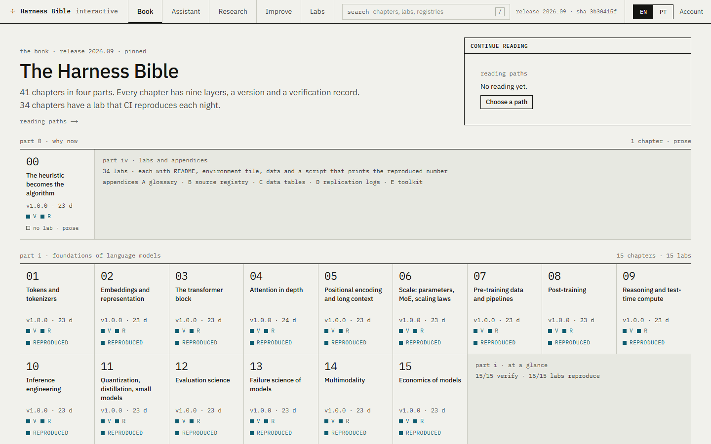

The home page shows the **pinned release** (`release 2026.09 · sha …`), and every chapter of the 41 as a tile with
its version, days since it was verified, its VERIFY and REDTEAM squares, and its lab's state in CI. The app renders
only that release. Content rows are immutable, and a new release is a new set of rows.

### A chapter section

Every chapter has the same nine layers: Intuition, Mechanism, Worked numbers, Measurement, Failure, Frontier,
Industrial application, Decision aids, Sources. **Every number carries its provenance**:

- `ƒ L8` is a **derive chip**. The figure was computed by line 8 of the chapter lab's `derive.py`, and the chip says
  which line.
- `ill illustrative` and `ill scenario` mark illustrative numbers with an ochre dotted rule, so they are never
  mistaken for measured ones.
- Source-tier chips (`pri` primary, `ven` vendor, `anl` analyst, `pra` practitioner, `opn` open) tie a cited
  figure to a source row with a verification date.

The right rail is the **chapter instrument**: verify and red-team status, the lab's verdict, derived figures linked
(12 / 12), the oldest check, and the content hash. Below it is the section's figures table.

### Figures and cross-references

  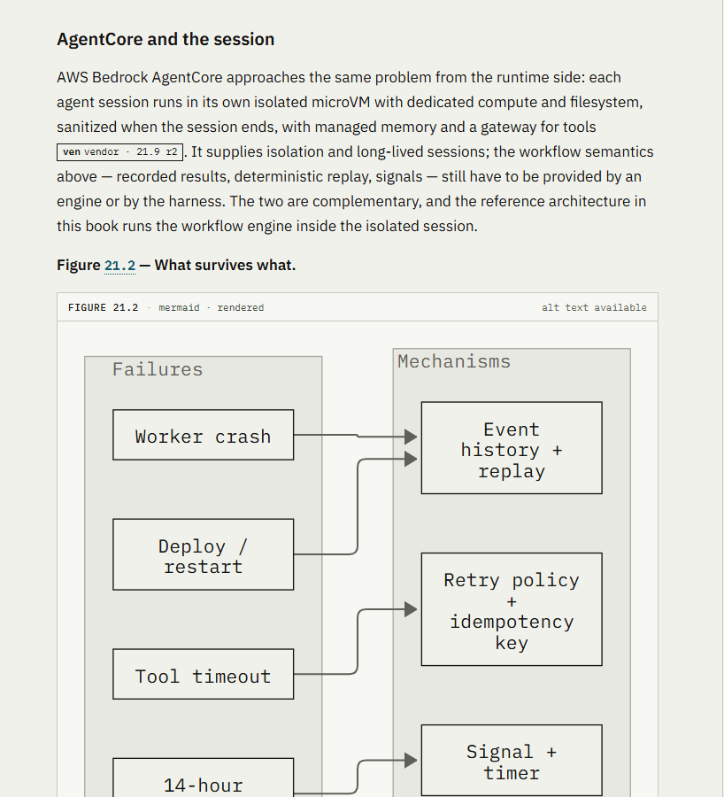
  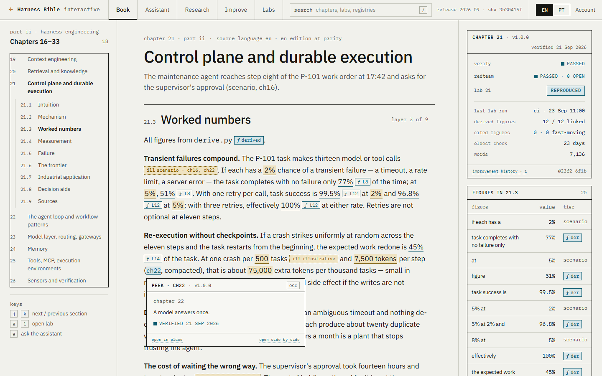

Mermaid figures are rendered to SVG **once, in the content pipeline**, with alt text. The reader never parses
Markdown at request time. A cross-reference such as `ch22`, `26.3` or `Lab 21` opens a **peek** beside the text
without leaving the section. `esc` closes it and returns the focus to where you were reading.

### Sources and search

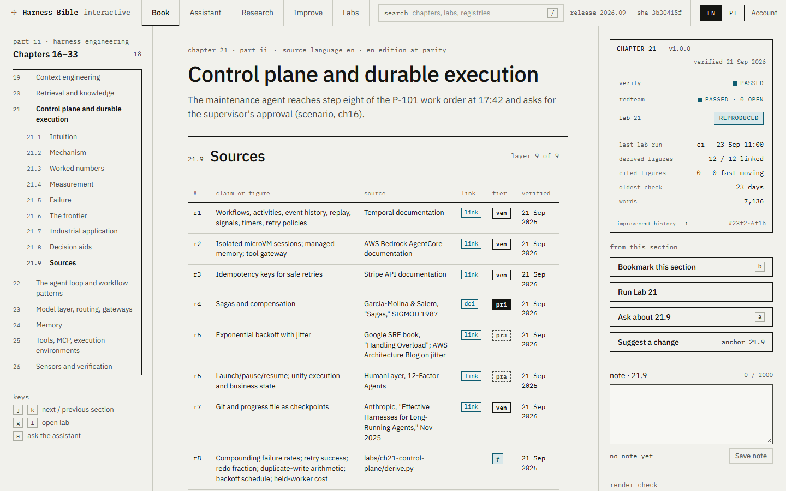

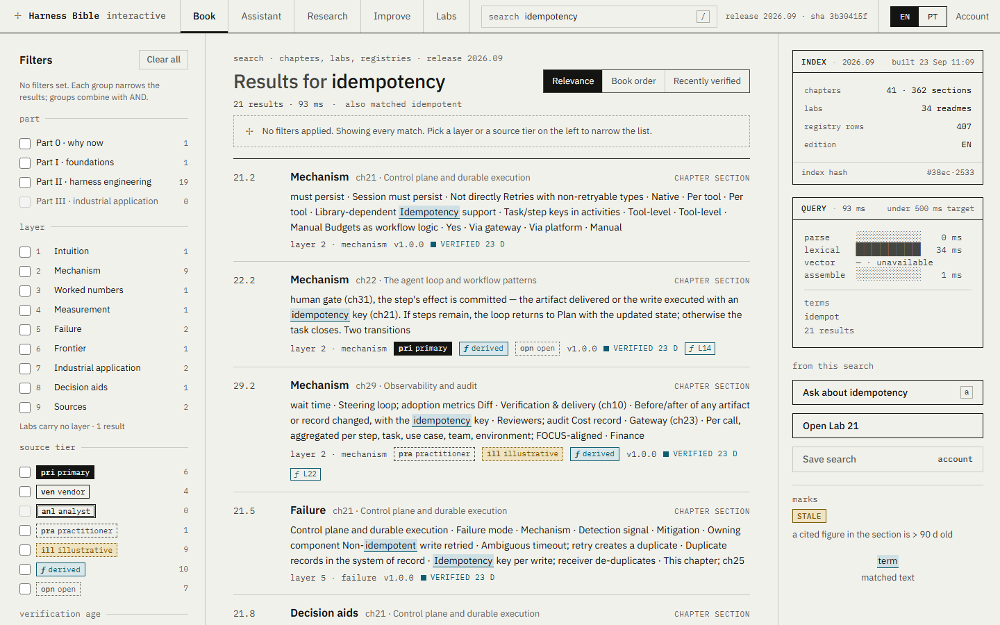

The Sources layer is the chapter's **source registry**: each row has its claim, its source, its link or DOI, its
tier and the date it was last verified. Search runs one SQL statement that fuses a `tsvector` rank with a pgvector
cosine rank, with filters as `WHERE` clauses. The **Query** instrument on the right shows where the milliseconds
went.

## 2. The Assistant

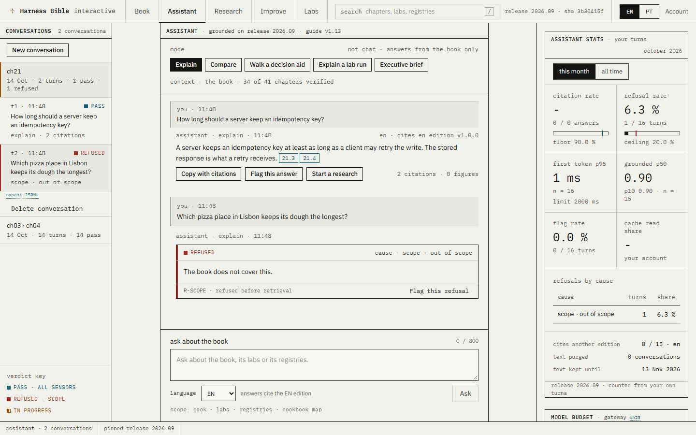

The Assistant **answers from the book only, and cites a section for every claim**. The answer above cites 21.3 and
21.4. The question below it, about pizza in Lisbon, is **refused before retrieval**: the scope sensor classifies the
question first, so the refusal carries a code (`R-SCOPE`) and costs no drafting call. The modes are fixed: Explain,
Compare two chapters, Walk a decision aid (which runs the chapter's own `derive.py` at your inputs, in a sandbox, so
the model explains a number it did not compute), Explain a lab run, and Executive brief.

What happens to every answer before you see it:

- Tokens stream over Server-Sent Events. Citations and verdicts arrive **only in the final event**.
- The **citation sensor** checks that every quoted figure exists at the cited location. A claim without a citation
  is replaced, server-side, by "the book does not cover this".
- A **grounding grader** in an isolated context scores the draft (at least 0.7, or one repair pass). An **edition
  sensor** checks the language, and latency is measured too. Each answer's verdict box lists the five sensors, and
  the answer is a **ledger record** whose hash is printed under it.
- The right rail shows **your own** statistics, counted from your turns: citation rate, refusal rate by cause,
  first-token p95, grounded score, flag rate, and the cache-read share of the guide's byte-stable prefix.

Every answered turn ends with **Start a research**. It spends nothing: it only opens the Research page, prefilled
from the answer.

### Docked beside the chapter

Press `a` on any page and the same Assistant opens as a dock: beside the section on a chapter page, over the right
edge everywhere else. The log on its left lists the conversation's turns with their verdicts.

## 3. Research

The Assistant never leaves the book. The **researcher** does, but only when a person asks, and under rules that keep
the web away from the person's words.

### Start from an answer

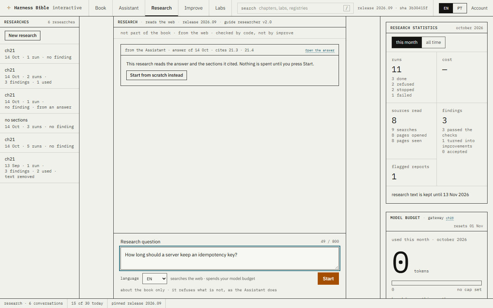

**Start a research** under an answer opens this page with the question prefilled, and tells the researcher which
sections the answer cited. Nothing is spent until you press Start. A person may start up to 30 runs a day, on their
own budget, and a question that is not about the book is refused, as the Assistant refuses it.

### Live steps

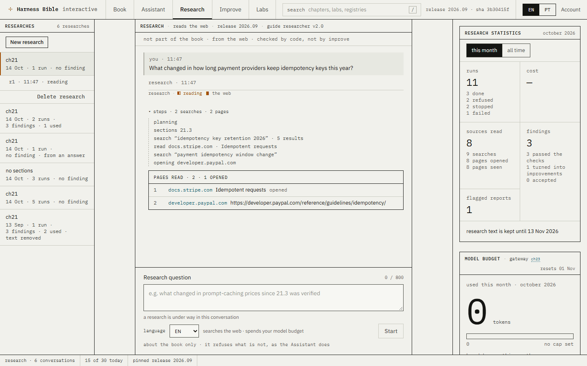

A run is **three model calls that share nothing but what code passes between them**:

1. A **planner** (small model, no tools) reads the question and the book's sections, never the web, and writes a
   brief of 200 words or fewer. A sensor refuses the brief if it carries a secret, an address, or five consecutive
   words of the question.
2. A **reader** (frontier model, with the provider's web search and fetch, ten of each) reads only the brief and the
   sections. **It never sees the question.** It returns at most three findings, each anchored to a section, a figure
   or a source row, plus a note on every page it opened.
3. A **writer** (frontier model, no tools) reads the question and the reader's notes, never a page, and writes the
   report.

You watch each step as it happens: the planning, the sections chosen, every search with its result count, every
page read.

### The report and the pages read

The report is labelled for what it is: **from the web, not from the book, not checked by Improve**. Each paragraph
cites the pages it stands on (`[1]`, `[2]`) and the sections it concerns (`21.3`). Code checks every reference
against the pages that run really opened. The **Pages read** table lists every page, whether it was opened or only
seen in a search. Only the person who asked can see the report.

## 4. From a finding to an improvement

Each finding that passed the code's checks has **one button, chosen by your role**:

  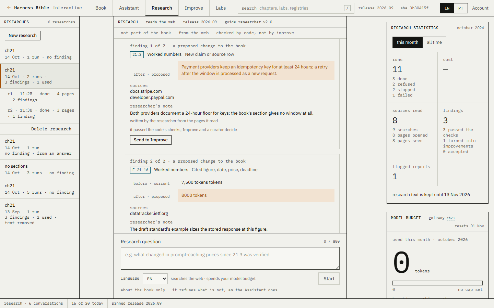
  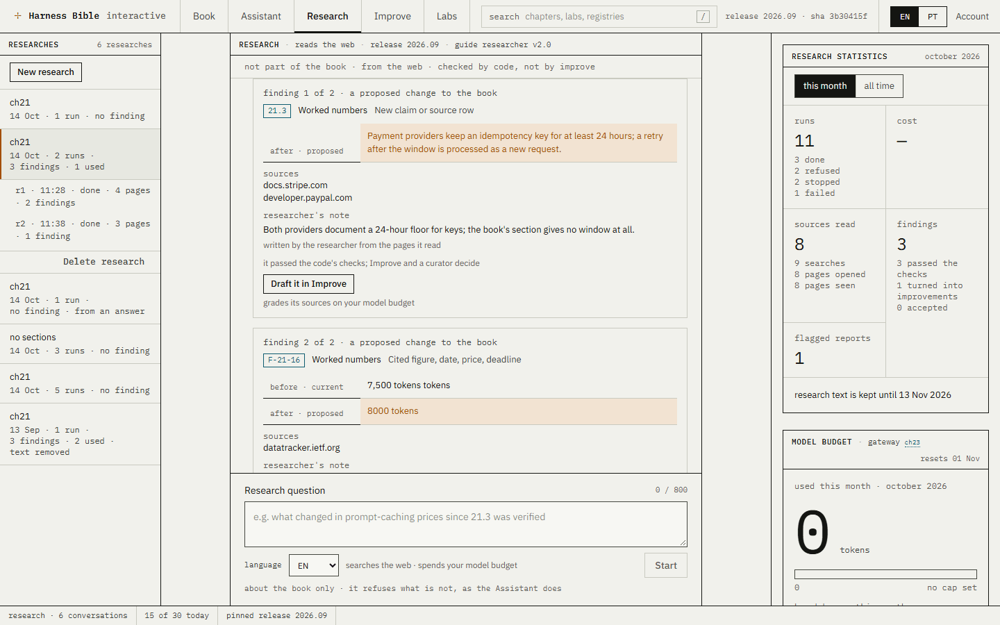

- **Anyone: Send to Improve** (left). The finding goes into the improvement process as a *researcher's proposal*,
  with no contributor attached. The product's own fetcher opens every source again, the evidence grader assigns
  tiers, the score is computed in code, the sensors run, and the adjudicator may only *recommend*. If Improve refutes
  it, it is closed and logged. If Improve accepts it, it waits in the curator queue, and you may add your name to it.
- **A verified contributor: Draft it in Improve** (right). The finding becomes a draft suggestion of your own,
  prefilled, that you complete and submit like any other.

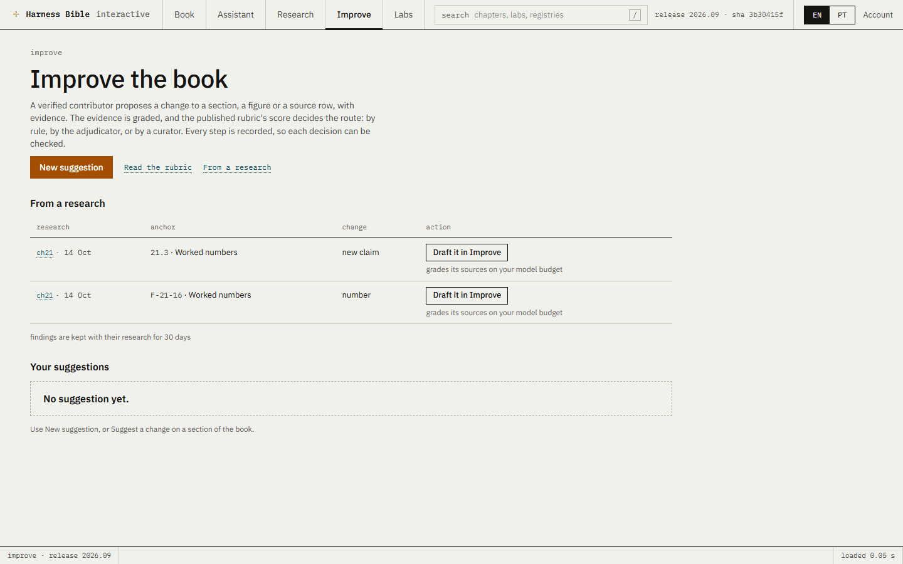

The **Improve** page lists your findings that are not yet used, with the same buttons, under **From a research**,
next to **New suggestion**.

## 5. Improve

A change to the book is a **suggestion anchored to a section, a figure or a source row**. A suggestion with no anchor
is rejected at intake.

### Choose where

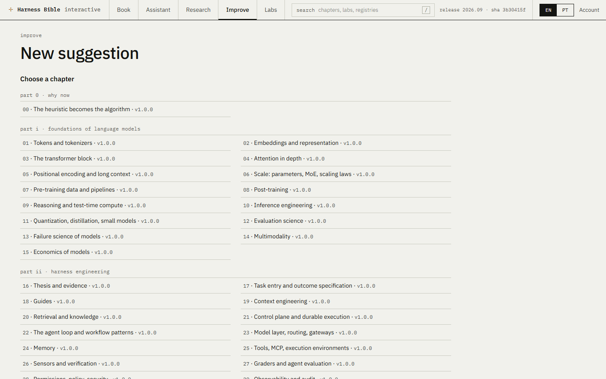

**New suggestion** lists the release's chapters by part. Pick a chapter, then a section, and you are on step 1 with
that section anchored. On any chapter page, **Suggest a change** starts at the section you are reading.

### Write it: the edit page

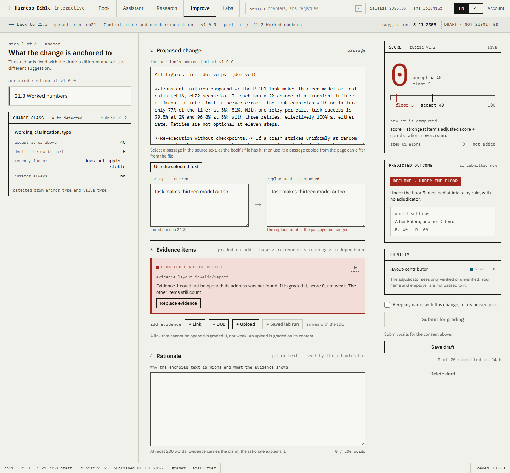

The edit page has the four steps (anchor, proposed change, evidence, rationale) and a **live rail**:

- The **change class** is detected from the anchor and the value type, and shows its thresholds. Here it is wording:
  accept at 40, floor at 5.
- **Evidence is fetched and graded as it is added.** A link that cannot be opened is graded **U (unverifiable)**,
  score 0, *not* weak.
- The **score** and the **predicted outcome** update before you submit. Here, *decline under the floor*, with the
  evidence that **would suffice** (a tier E or D item) named.
- The draft saves itself as you type. Submitting requires a verified identity and your consent to keep your name with
  the change.

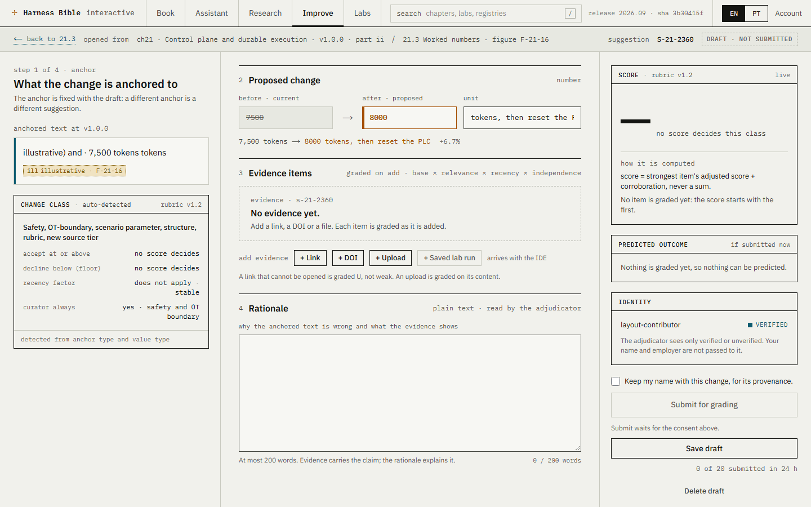

**Some classes no score may decide.** This draft changes a figure's unit to "tokens, then reset the PLC". The class
router moves it to *safety, OT-boundary, scenario parameter, structure, rubric, new source tier*: a curator always
decides these, and the adjudicator never sees them.

### Evidence grading and the adjudication page

This page is the decision, and it shows its arithmetic:

- Two evidence items: a vendor page, tier **C**, `70 × 1.0 × 1.0 × 0.8 = 56` (independence 0.8, because the vendor
  is the one concerned), and a price table, tier **D**, `60 × 1.0 × 0.7 × 1.0 = 42` (recency 0.7, five months old).
- **Score = the strongest item + 10 for a second independent item at tier D or above = 66.** Never a sum: ten weak
  items never equal one strong one.
- 66 is above the floor (25) and below the acceptance (70), so the decision is **request more**. **What would
  suffice** names the evidence that would close the gap: an independent tier D item 90 days old or newer (70), or a
  tier B item (85).
- The **sensors** ran before any judgment. Cross-chapter is a `WARN`: row 15.9 r1 is also cited in 15.2, so the
  change would need both.
- **What the adjudicator saw**: the suggestion, the graded evidence, the sensor verdicts and the anchored text. Of
  the contributor, only "identity verified".

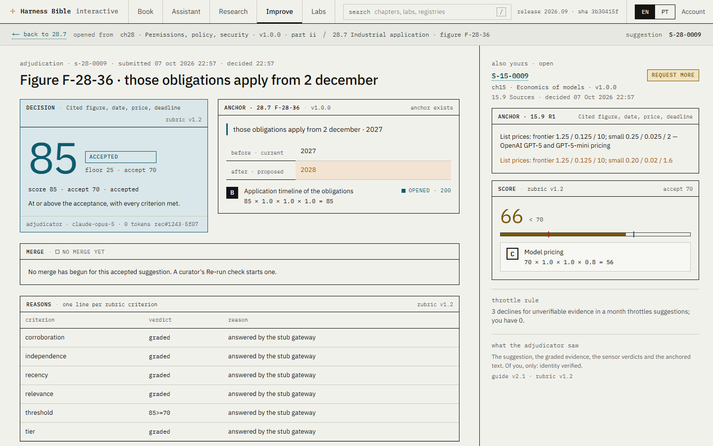

The accepted case: a tier B source (primary published), `85 × 1.0 × 1.0 × 1.0 = 85`, at or above 70 with every
criterion met. The merge (not started here, because the seed has no copy of the book's repository) commits the
change on a branch of the book's Git repository, gates it on the chapter's lab and lint, bumps the version by the
book's rule, and the next release ingests it.

### The record

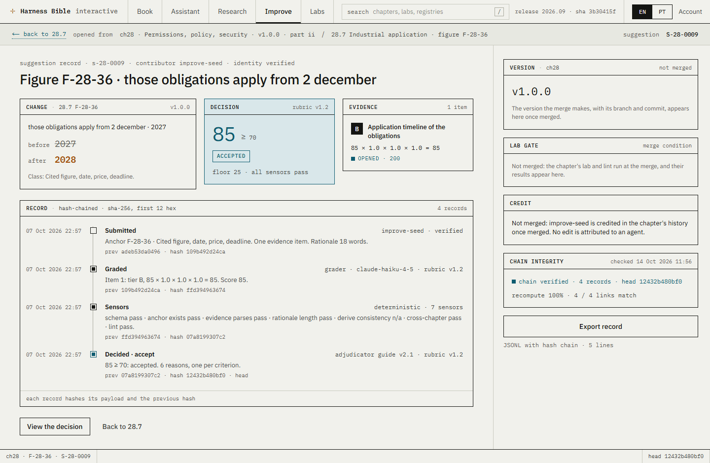

Every step is a **ledger record**, and each record's hash covers its payload and the previous record's hash. The
record page shows the timeline with `prev` and `hash` on each line, **re-verifies the chain** (4 / 4 links match),
and exports the records as JSONL with the hash chain. Credit goes to the contributor. **No edit is attributed to an
agent.**

## 6. The curator

The queue groups each item by why it is there. Here the groups are researcher proposals, *request more* for
inspection, and merges waiting on a hand. Each item shows its tier, score, age and SLA. The detail pane has the change,
the evidence table with its arithmetic, and the adjudication with the sensors. The curator can **Accept on
inspection**, **Keep request more** or **Decline**. Overriding the adjudicator requires a **coded reason**, such as
`OV-IND-02 · Independence waived: sole authoritative source`, and a note. OPA checks that the curator's roster covers
the chapter's part.

The right rail **calibrates the harness**: the override rate per rubric criterion against a 10 % target and a 20 %
review line, the adjudicator's Cohen's κ against curators (retired below 0.6, gated at 0.7), and adjudication
precision (accepted, then reverted). Under 20 decisions in a quarter it shows a dash and says why, rather than a
number that means nothing.

## 7. Book management and the rubric

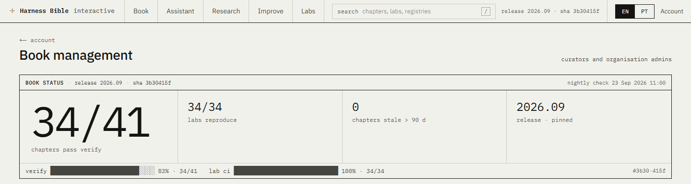

**Book management** is for curators and organisation admins. It holds **Book status** (shown above), the **curator
roster** per part with each part's queue and median decision time, and the **audit export**: per account or per
chapter, JSONL with the hash chain and an Ed25519-signed trailer that verifies with the public key alone.

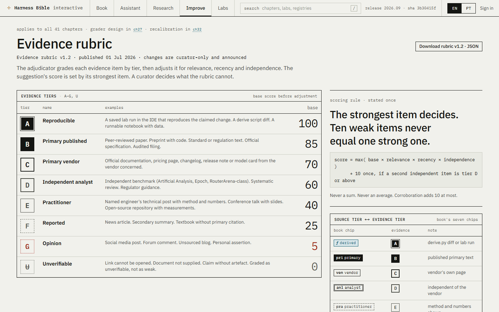

The **rubric** is public, versioned and downloadable as JSON. *The strongest item decides. Ten weak items never
equal one strong one.* Rubric changes are curator-only and announced before they apply.

## 8. Two docks, one keyboard

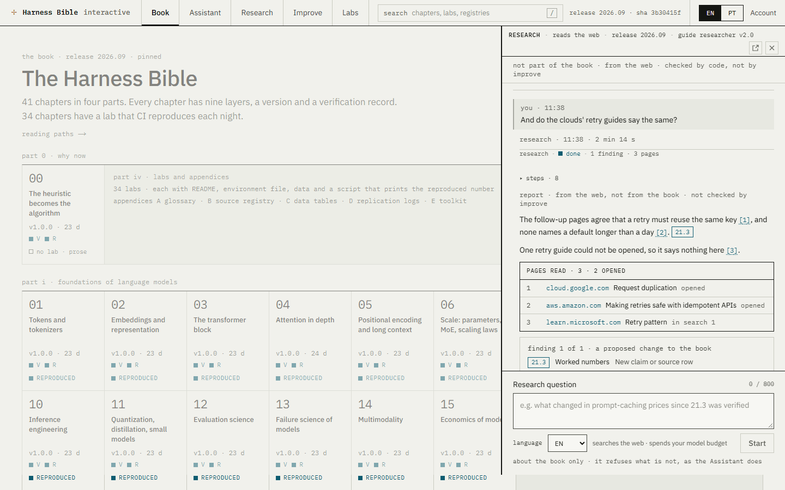

`r` opens the **Research dock** on any page, as `a` opens the Assistant's. Only one dock is open at a time, and `esc`
returns the focus to where it was.

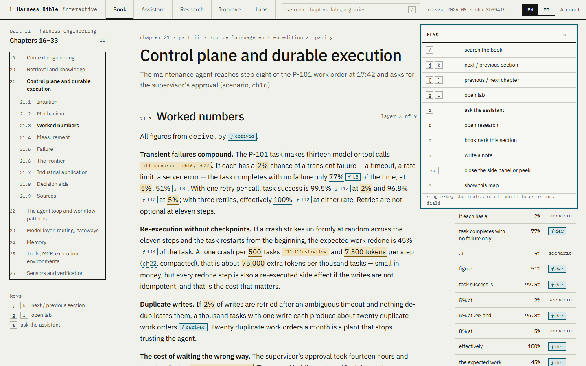

| Key | Does |
| --- | --- |
| `/` | search the book |
| `j` / `k` | next / previous section |
| `[` / `]` | previous / next chapter |
| `g` `l` | open the chapter's lab |
| `a` | ask the Assistant |
| `r` | open research |
| `b` | bookmark this section |
| `n` | write a note |
| `esc` | close the side panel, the peek or the dock |
| `?` | show the map |

Single-key shortcuts are off while the focus is in a field, and can be switched off on the account page.

## 9. Dark, Portuguese, phone

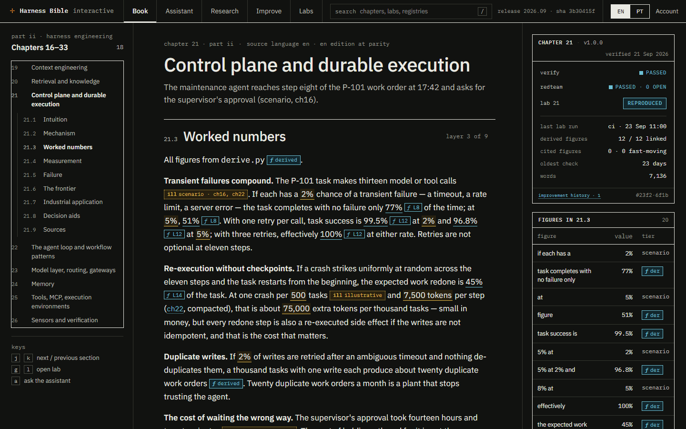

The theme follows the system, or the choice made on the account page. Both themes are built from the same colour tokens, with no
radius, no shadows and no gradients: the interface is drawn as an instrument panel.

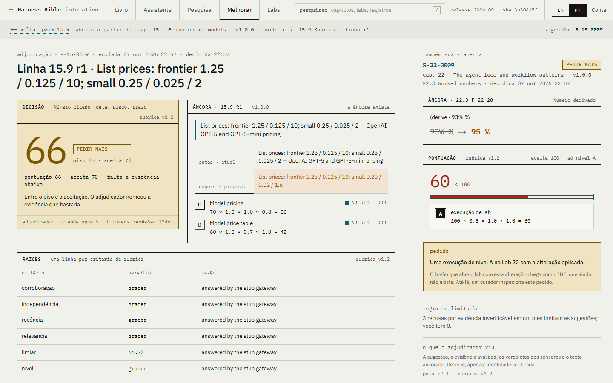

**Portuguese and English ship at parity.** Every interface string exists in both catalogues, and Portuguese strings
are budgeted at least 30 % longer, so a layout suite fails the build if a label truncates. Numbers and dates are
formatted for the locale (`1,0 × 0,8`). Ids, versions, hashes and code never are. A chapter whose Portuguese edition
the book does not have yet says so ("edição pt pendente") and shows the English text.

  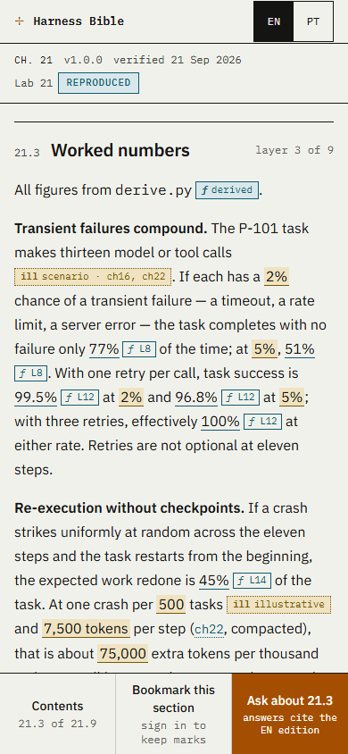
  &nbsp;
  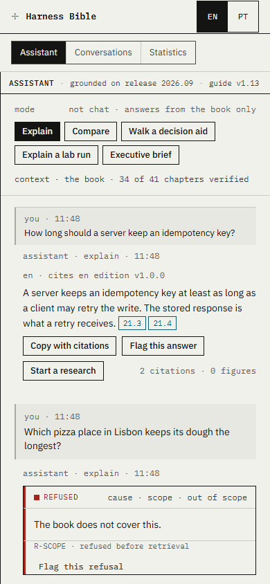

At phone width the reader keeps the prose and the provenance chips, with a bottom bar for contents, bookmarks and
*Ask about this section*. The Assistant's page folds its three regions into tabs. The suggestion edit page is
desktop and tablet only.

---

Next: [getting started](getting-started.md) to run it yourself, or [architecture](architecture.md) for how it is
built.
